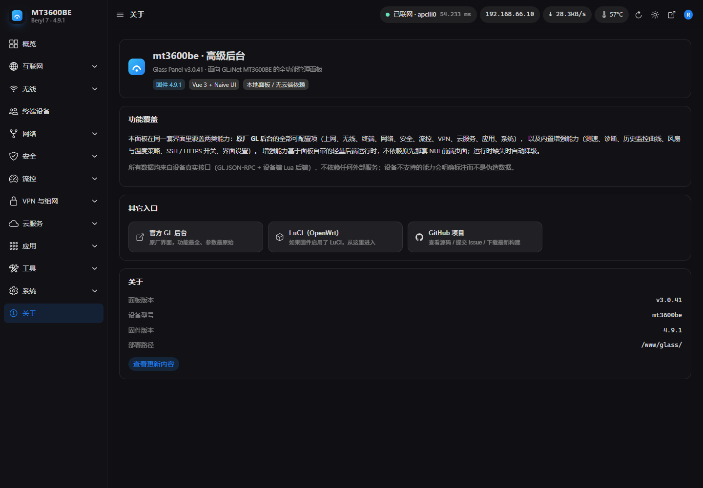
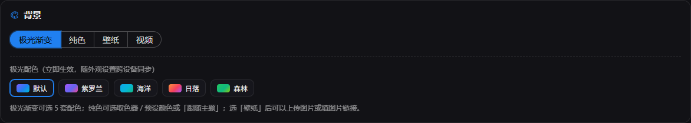
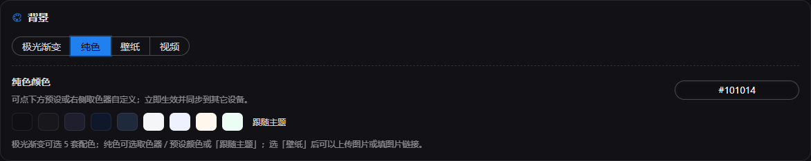
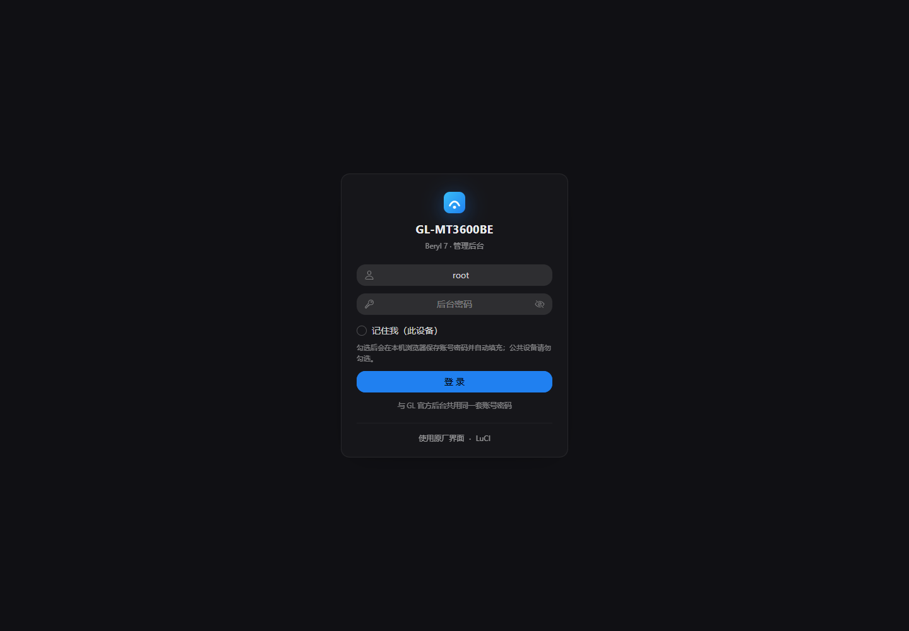

# GL-MT3600BE · 高级后台 v3（Glass Panel）

> 开源版本：前端源码 + 自建 `glass`/`nui` 后端与打包脚本。
> 真机文档、抓包样本、截图与厂商 NUI 运行时未包含在仓库中；使用前请自行确认目标固件的兼容性。

面向 **GL.iNet GL-MT3600BE（Beryl 7，固件 4.9.0 / OpenWrt 21.02 / mt7987）** 的全功能管理面板：
Vue 3 + TypeScript + Naive UI 单页应用，部署在设备 `/www/glass/`，可选接管根路径 `/`。

它把**两套后端能力合并成一个后台**：

| 来源 | 覆盖方式 | 说明 |
|---|---|---|
| GL.iNet 官方 SDK4 后台（52 个视图 / 48 条菜单） | 浏览器直调 `POST /rpc`（与官方后台同源同权、同一套账号密码） | 上网、无线、终端、网络、安全、流控、VPN、云服务、应用、系统全部覆盖 |
| NRadio NUI 插件（`luci-app-nradio-nui` 1.2.0-11） | 自建 `rpc/nui` 桥对象，在设备端直接 `require luci.nui.m_*`（复用插件 109 个后端方法） | 蜂窝深度信息、锁频/锁小区、AT、测速、诊断、监控、风扇策略、SSH/HTTPS、界面设置 |
| 官方没暴露的实时指标 | 自建只读 `rpc/glass` 对象 | CPU 各核占用、多路温度、风扇转速、内存/磁盘/负载、联网检测、静态路由、测速、诊断 |

> 本机实测**没有蜂窝模组**（`build_in_modem=""`、`cellular.modem info → modems:[]`、无 `/dev/ttyUSB*`）。
> 蜂窝/SIM/短信/锁频/AT 页面按「能力不可用」降级：显示真实证据链与诊断信息，**不伪造信号数据**；
> 换到带 5G 模组的同固件设备上，这些页面的数据路径已经按官方 `modem.*` / ubus `cellular.*` 写好。

## 功能覆盖（59 个页面 / section）

```
概览
蜂窝网络   状态 · SIM 与 APN · 锁频与锁小区 · 流量统计 · AT 调试 · 短信
互联网     上网设置 · 多 WAN 与切网
无线       Wi-Fi 设置（含 Wi-Fi 7 / MLO） · 访客与 IoT · 中继与桥接 · 黑白名单
终端设备
网络       局域网与 DHCP · 静态地址绑定 · DNS · IPv6 · 端口映射与 DMZ · 静态路由 · IGMP · 高级网络
安全       防火墙 · 访问控制 · 远程访问管理 · 家长控制 · 应用管控（DPI + 内容保护）
流控       流量统计 · QoS · SQM
VPN 与组网 概览 · 客户端 · WireGuard/OpenVPN 服务端 · Tailscale · ZeroTier · Tor
云服务     GoodCloud · DDNS · SD-WAN / AstroWarp
应用       插件管理 · 文件共享 · AdGuard Home
工具       网络测速 · 网络诊断 · 历史监控 · 联网检测
系统       系统信息 · 账号与 SSH · 固件升级 · 定时任务 · 时区 · 按钮 · 风扇与温度 · 重启恢复 · 日志 · 高级 · 界面设置
关于
```

官方后台（`/gl_home.html`）保持可访问；NUI 原版前端页面（`/nui/`）已随插件移除，面板自带所需的最小后端运行时，测速/诊断/监控/SSH/风扇增强继续可用。


### 全局刷新频率（界面设置）

`系统 → 界面设置` 新增「刷新频率」：2 / 3 / 5 / 10 / 15 / 30 / 60 秒可选，保存即生效并记住；
影响概览指标、顶栏网速/IP、互联网状态、无线、终端、系统信息、风扇、按钮位置等所有自动刷新页面
（测速/诊断等“正在跑的任务”按任务自身节奏刷新；会话心跳固定 60 秒不受影响）。
顶栏的 ↓/↑ 网速与 IP 现在在任意页面都会持续刷新（修复了离开概览后停更的问题）。

### 高级设置里的官方入口

`系统 → 高级设置` 底部新增「官方入口」：GL 官方后台、官方风扇控制（gl-fanctrl）、官方按钮设置、
官方固件升级、官方系统日志、官方重启/恢复、官方网络设置、OpenWrt LuCI（未安装时置灰），
新标签页直达，改动会同时反映到本面板。


## 依赖与致谢

- **风扇控制**（`系统 → 风扇与温度`）依赖开源插件 **gl-fanctrl**：<https://github.com/XIAOZHAOXSXH/gl-fanctrl>。
  未安装该插件时，风扇控制相关页面/接口会自动降级，不会影响面板其他功能。

## 安装 / 升级 / 卸载

```sh
# 安装（设备上）
opkg install --force-reinstall /tmp/gl-glass-panel_3.1.0-1_all.ipk

# 卸载（还原入口，官方后台不受影响）
opkg remove gl-glass-panel
```

安装后：

- `http://路由器地址/` → 302 到 `/glass/` 高级后台（由 `zz-glass-root.conf` 接管，可单独删除还原）
- `http://路由器地址/glass/` 直接进入面板
- `http://路由器地址/gl_home.html` 原厂 GL 后台

## 构建与发布

```powershell
npm install
npx vue-tsc --noEmit && npx vite build     # 前端类型检查 + 构建
python tools/build-ipk.py                  # 打包 ipk（版本号见 src/version.ts 与 ipk/src/control/control）
```

生成的安装包在 `dist/` / `ipk/`；仓库不包含历史构建产物。发布前建议在目标设备上跑：

```powershell
$env:GL_PASS='<后台密码>'; node tools/verify.mjs --host <路由器地址> --base https://<路由器地址>/glass/
```

> 本项目只包含面板源码；真机文档、抓包样本与验收截图不随仓库发布。使用前请确认目标固件版本与机型，误操作可能导致设备失联。

## 已知限制

- **本机无蜂窝模组**：蜂窝相关页面只做降级展示；换带模组的设备即可按已实现的官方 `modem.*` 路径工作。
- NUI 增强功能的「写」入口（如风扇智能曲线、温度提醒）依赖插件运行时与插件自身的 `nui` 配置；
  本机插件是手工铺设（非 opkg 安装），升级插件后我们的补丁模块可能被覆盖，重装本包即可恢复。
- 少数官方功能必须官方界面配合（如配置备份/恢复走 LuCI `cgi-backup`、固件在线升级的完整流程），
  面板提供入口与状态，具体写入仍以官方后台为准（页面已注明）。
- 根路径接管可通过删除 `/etc/nginx/gl-conf.d/zz-glass-root.conf` 还原，无需卸载。


## 界面截图






## 安装包

最新构建：`release/gl-glass-panel_3.1.0-1_all.ipk`；当前版本更新内容见 `release/RELEASE_NOTES.md`。

## 开源说明

- License: MIT（见 `LICENSE`）。
- 仓库只包含面板自身源码；`docs/`（真机 API 取样、截图）、`deploy/`（本机部署脚本）和厂商 NUI 运行时不入库。
- 自建后端源码在 `ipk/backend/`，打包脚本在 `tools/build-ipk.py`；发布前请用 `npx vue-tsc --noEmit && npx vite build` 验证。
- 设备地址、账号密码等运行参数通过环境变量/界面配置，源码中不包含真实凭据。
